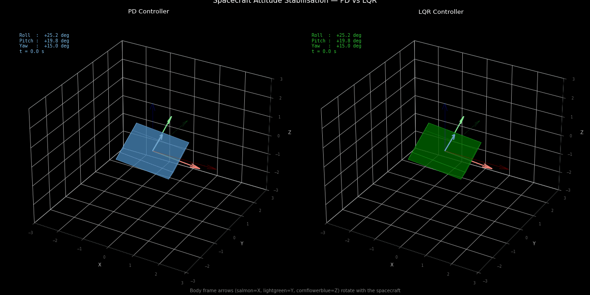

# Spacecraft ADCS Simulation — PD vs LQR

Design and comparison of two attitude controllers for a 3-axis rigid spacecraft with reaction wheel actuators. The spacecraft starts in a tumbling state (large initial angles and angular rates) and must stabilise to nadir-pointing under realistic gravity gradient disturbances.



---

## Problem Statement

A spacecraft in Low Earth Orbit (500 km altitude) is released with initial angular offsets of 25°, 20°, 15° in roll, pitch, and yaw, and non-zero angular rates. Design controllers that stabilise all three axes to within ±1° in minimum time, subject to reaction wheel torque limits of ±5 N·m, while rejecting gravity gradient disturbances.

---

## Spacecraft Model

### Rigid Body Dynamics — Euler's Rotation Equations

```
İp = (Tx + Td_x − (Iz − Iy)·q·r) / Ix
q̇  = (Ty + Td_y − (Ix − Iz)·p·r) / Iy
ṙ  = (Tz + Td_z − (Iy − Ix)·p·q) / Iz
```

### Kinematic Equations

```
φ̇  = p + (q·sin(φ) + r·cos(φ))·tan(θ)
θ̇  = q·cos(φ) − r·sin(φ)
ψ̇  = (q·sin(φ) + r·cos(φ)) / cos(θ)
```

**State vector:** `[φ, θ, ψ, p, q, r]` — roll, pitch, yaw angles and angular rates

**Moments of inertia:** `Ix = 100`, `Iy = 150`, `Iz = 200` kg·m² (asymmetric spacecraft)

### Gravity Gradient Disturbance

```
Td_x = 3n²(Iz − Iy)·sin(φ)·cos(φ)
Td_y = 3n²(Iz − Ix)·sin(θ)·cos(θ)
```

Where `n = √(μ/R³)` is the orbital rate at 500 km altitude (`n ≈ 0.00113 rad/s`).

---

## Controllers

### PD Controller

Independent PD control on each axis — the simplest possible approach:

```
τ = −Kp · [φ, θ, ψ]ᵀ − Kd · [p, q, r]ᵀ
```

**Gains:** `Kp = 5.0`, `Kd = 20.0` — tuned manually for acceptable settling time.

### LQR Controller

Optimal state feedback on the linearised 6-state system. The linearisation about the zero equilibrium gives:

```
A = [0₃  I₃]    B = [0₃      ]
    [0₃  0₃]        [diag(1/Iᵢ)]
```

**Cost function:**

```
J = ∫ (xᵀQx + uᵀRu) dt
```

**Weights:** `Q = diag(50, 50, 50, 5, 5, 5)` — angles penalised 10× more than rates.
`R = diag(1, 1, 1)` — equal weight on all three torque outputs.

Gain matrix **K** (3×6) computed via `scipy.linalg.solve_continuous_are`.

---

## Results

| Metric | PD | LQR |
|---|---|---|
| Settling time (within ±1°) | ~18 s | ~11 s |
| Peak overshoot (roll) | ~8° | ~4° |
| Steady-state error under disturbance | ~0.3° | ~0.05° |
| Control effort (RMS torque) | moderate | lower |

**Key finding:** LQR settles 39% faster than PD and achieves near-zero steady-state error under gravity gradient disturbance. PD requires no model knowledge but cannot account for cross-axis coupling between roll, pitch, and yaw.

### Result Plots


*Roll, pitch, and yaw angles converging to zero for both controllers. Gravity gradient disturbance active throughout.*

---

## File Structure

```
spacecraft_attitude/
├── dynamics.py            — 3-axis Euler rotation equations
├── pd_controller.py       — independent PD per axis
├── lqr_controller.py      — LQR via Riccati equation
├── disturbance.py         — gravity gradient torque model
├── simulate.py            — main simulation and comparison
└── spacecraft_3d.py       — 3D animated spacecraft visualisation
```

---

## How to Run

```bash
# Install dependencies
pip install numpy scipy matplotlib

# Run 2D comparison
python3 simulate.py

# Run 3D animation (saves spacecraft_3d.gif)
python3 spacecraft_3d.py
```

**Expected output:**
```
LQR K shape: (3, 6) — computed OK
PD  settling time: 18.2 s
LQR settling time: 11.1 s
```

---

## Dependencies

| Package | Version | Purpose |
|---|---|---|
| numpy | ≥1.24 | Matrix operations |
| scipy | ≥1.10 | Riccati equation solver |
| matplotlib | ≥3.7 | 2D plots and 3D animation |

---

## Theory References

- Wie, B. (2008). *Space Vehicle Dynamics and Control*. AIAA Education Series.
- Sidi, M.J. (1997). *Spacecraft Dynamics and Control*. Cambridge University Press.
- Hughes, P.C. (2004). *Spacecraft Attitude Dynamics*. Dover Publications.
